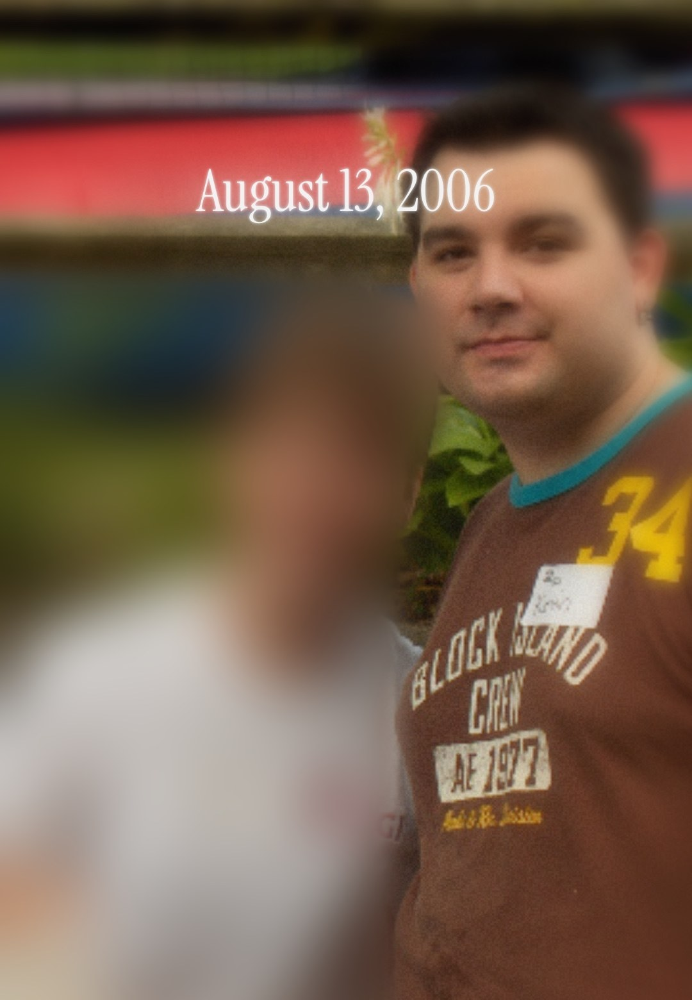

My philosophy on life: if I have to do it anyway, I might as well have fun doing it. And I describe myself as [seriously unserious](https://www.linkedin.com/feed/update/urn:li:activity:7415029966599389184/). I take the work seriously, but we don't have to be so serious all the time.

These ideas touch almost everything I do. I spent several days exploring NYC's boroughs placing [70 QR stickers](https://www.linkedin.com/feed/update/urn:li:activity:7414305267422531585/) so I could meet and network with people. Each one pointed to a silly little mini site showing a different side of me: [/catdad](https://middleton.io/catdad/), [/nyc](https://middleton.io/nyc/), [/fixer](https://middleton.io/fixer/), and [/officehours](https://middleton.io/officehours/) (which later grew into its own thing). There's also [/kevin](https://middleton.io/kevin/), which I made purely for the fun of it.

I even recreated my [portfolio as an operating system](https://middleton.io/kevinos/), and my site is full of easter eggs. There's no reason for any of them except that I love making them.

### Nobody believed in the ice cream truck (except me)

My first job out of college was in rural Southwest Virginia, and I didn't have any friends there yet. Our office had only opened that January, the company's [first in rural America](https://www.cgi.com/en/cgi-dedicates-new-southwest-virginia-technology-center-excellence-governors-kaine-and-warner), and we were still working out of temporary space. I was part of the inaugural group, so when we put together a committee for the first annual company picnic, I volunteered, because I wanted to help.

We DIY'd the entire event. A small committee of five or so of us planned, booked, decorated, catered, cooked, and ran our own company picnic! We even had to reserve a pavilion at a park in Bristol. We didn't have proper catering, so a coworker and I went to Walmart and filled two carts absolutely stuffed with hot dogs, hamburgers, chips, and snacks. We had something like a $500 budget.

We got face painting. We got a bounce house. But there was something magical missing, and I was obsessing over it. Then it finally came to me: everyone loves an ice cream truck. Kids love it because it's ice cream, and adults love it because it reminds them of when they were a kid.

The committee was getting frustrated with me. They thought I was obsessed with this ice cream truck, and they weren't wrong. I said "remember when you were a kid?" and they looked at me like I was crazy. I mean, I am, but I was right! And I could not find an ice cream truck to save my life. So I opened the white pages and started calling anything close to an ice cream truck until someone knew of one.

The ice cream truck was the standout hit. The adults lined up. The kids lined up. Nobody had to pay for anything; they just got to enjoy ice cream. It was magical. ✨

It took work, and I almost gave up. But I'm weirdly relentless like that. I really do care about fun. Almost twenty years later, that same coworker found a photo from the picnic and sent it to me. "You make everything amazing," she said.

### Fun is what keeps me going

A former colleague, a UX lead, is emphatic about this: "You can make a button fun!" Any button, in any app. If a button can be fun, so can pretty much anything you're building.

I also have to give a shout-out to my favorite Spanish teacher. Her wanton kookiness inspired me. She'd tell us they didn't pay her extra for the sound effects, they were free. Sound effects really are free, and I can't believe we don't get paid extra for them!

A friend once warned me off becoming a regular content creator: "The expectations become obligations." I'm far too reserved for that anyway, I think.

That's why fun matters to me. I try to have fun with whatever I do, and everything else in this post comes from that.

### Let your silly side guide what you build next

Have something you want to build, or a project you want to kick off? If there's a fun way to go about it, choose the fun path.

Build something because you find it useful. Write a post because you have something to say. Share it however you like, on LinkedIn or on a blog, and stop caring whether it gets likes. It probably won't get many, and that's okay.

When you make something for yourself first, the bar is whether it helped you, and you can clear that bar every time. Hopefully someone else finds it helpful too. Repeat this and keep going.

### Have fun learning it

Most of us have a gap somewhere: a skill a dream job asks for that we haven't been asked to use in our current or previous roles, or a subject we want to know better.

You don't have to accept the gap just because you haven't been formally asked to solve that problem in a work setting. You can teach yourself something new in the most enjoyable way you can think of. Build something in your area of weakness and post about it. Write about the subject while you learn it. Team up with other people who want to learn it, too. You can do it however you decide. **_How cool is that?!_**

With AI tools it's never been easier. You don't need permission or even money. You need a little time and something you want to build.

Learning this way also gives you something to do. If you're in a lull or between things, the days can blur together. Building something lets you set personal milestones. You can wake up with a next step. Think through a small problem during your walk. You're solving problems that you want to solve, and learning along the way.

And when it's fun, the learning sticks, because you actually want to come back to it.

### Make "what have you been working on?" fun to answer

People ask me "what have you been working on?" all the time, at office hours and over coffee, and I love this question!

I pull up my portfolio and show them a few things I've been building lately.

Clockwise from top left: [Office Hours](https://middleton.io/officehours/), [Unpaid Intern](https://middleton.io/unpaid-intern/), [KevinOS](https://middleton.io/kevinos/), and [Recruiter BFF](https://middleton.io/recruiter-bff/).

I built these in my spare time, and I had so much fun doing it. Maybe they'll go somewhere. They probably won't. And that's okay!

It might take one minute to talk about these with someone, but in that minute they can see your enthusiasm, and that you're actively building something right now. That leaves a great impression, and it's a lot more fun to talk about than the weather.

### Your people will find you

My [office hours](https://middleton.io/officehours/) started as something I made from nothing. GitHub Pages is free. Calendly is free. I put up a page and a booking link, and I've met dozens of people through it.

I get feedback on the things I'm building. I help people think through their problems, which keeps me sharp and current and teaches me new ways to dig into problems of my own. These are people I'll keep in touch with for years, people I can lean on and trade feedback with.

Recently a senior analyst who'd been searching for almost a year messaged me after one of my posts. He'd been using AI to tailor every resume, and he could tell the results read like fluff. I gave him some feedback he can use on his resume. Neither of us was selling anything. He found me because I'd shared something I made.

Most people only network when they're in danger. They reach out the week they need a job, and it feels transactional, because it is.

Office hours turned networking into something I enjoy, so I actually do it.

### Go build something fun

The alternative is for everything to be boring, silent, even uncomfortable or difficult. Why would we do that to ourselves? We're working together. If we can choose to make it fun, we should choose it as often as we can.

Pick something you want to make. Keep going, and have fun doing it.

Someone will notice. Those are your people.
