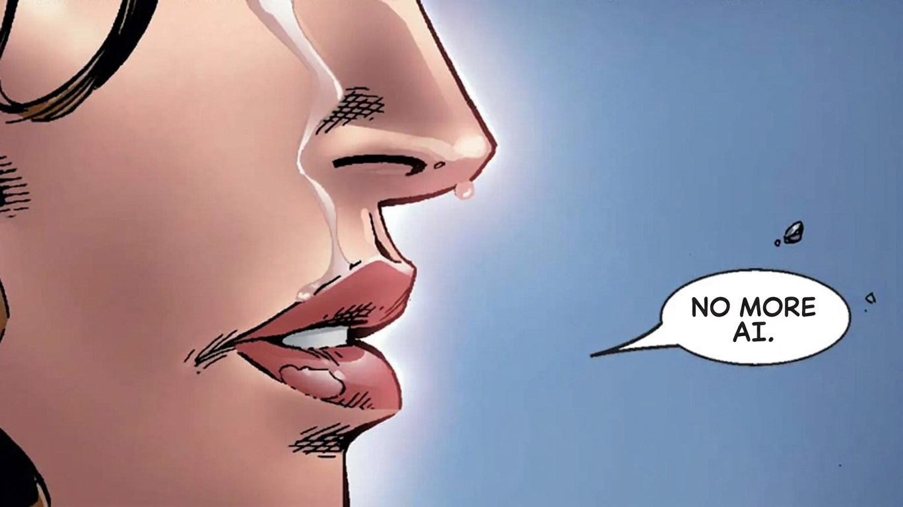
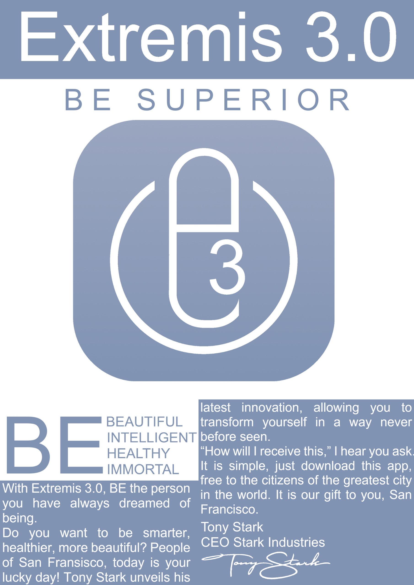
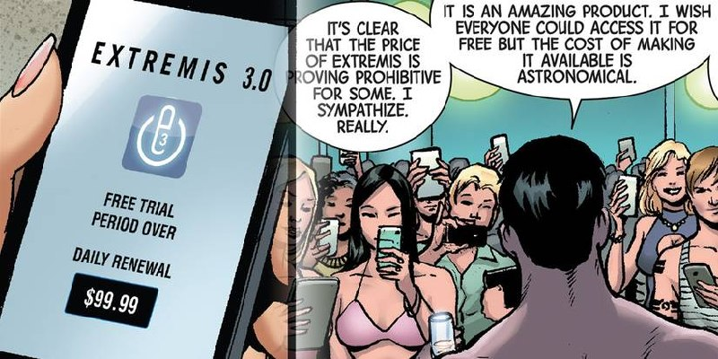
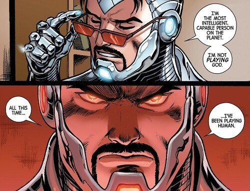

In 2005, the Scarlet Witch looked at a world crowded with superpowers and said three words: "No more mutants." Nearly every mutant on Earth woke up powerless.

Some days I want to borrow her for a morning and swap one word.

## Even I'm getting bored of it

I know it's ironic. I put my notes together with AI, I build with AI, and I pay for premium AI every month (more than one service, if I'm keeping score). I love this stuff, because I love technology.

But some days I wake up and wonder what would happen if AI simply didn't exist. It's wishful thinking, I know. That's not the world we live in. Still, some days I think about being Amish.

I can't get through a conversation, a meeting, or anything I read online without it touching AI. We've hit this hyper-saturated point where it's all anyone talks about, and even I have to say I'm getting bored of it at times.

## Marvel already tried this in San Francisco

I lived in San Francisco for 10 years, and I still keep in touch with people there. Apparently the city is just inundated with AI apps right now.

Which is funny, because Marvel did this exact story in 2014. In *Superior Iron Man* #1, Tony Stark picks San Francisco to beta-test his newest invention, the Extremis 3.0 app. The pitch is right on the poster: "BE beautiful, intelligent, healthy, immortal." And it's free to everyone in the city. "It is our gift to you, San Francisco."

Everyone downloads it, and everyone loves it. Then the free trial ends.

Daily renewal: $99.99. Tony's explanation sounds like a real pricing announcement: "It is an amazing product. I wish everyone could access it for free but the cost of making it available is astronomical."

Free until you can't live without it, then a shrug about what it costs to run. That comic is 12 years old, and it reads like a product roadmap.

## The Stark comparison writes itself

Tony gets compared to real tech billionaires all the time, Elon Musk most of all. Robert Downey Jr. even suggested meeting Musk while they were building the movie version of Tony, and Musk has a cameo in *Iron Man 2*.

The comic version is the one worth reading, though. Superior Iron Man is Tony with his conscience switched off, a genius who has decided he knows what's best for everyone.

## I'm looking forward to the pendulum swing

There's already some talk of Gen Z going back to analog products, and of people stepping away from phones loaded with every feature. I'm kind of looking forward to that swing.

What I actually worry about is us. We're not doing enough analog things in our day, we're not seeing enough of our friends, and we're not even collaborating enough at work. I think that becomes a real problem for us as a society, especially as we pull more people into the AI psychosis of it all.

Wanda's wish was a disaster, so I'm not asking for that, and I definitely don't want Tony's app. Some days I just wish we could sit down and talk.

When's the last time you did something with your friends that no app was part of?
