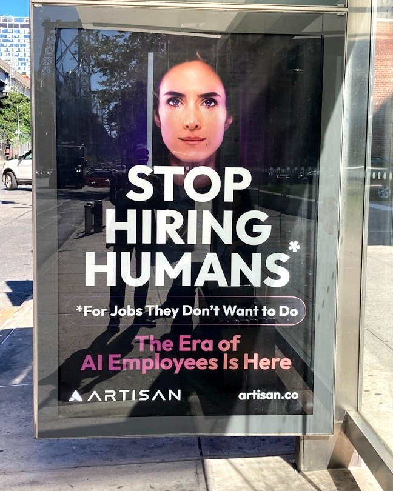
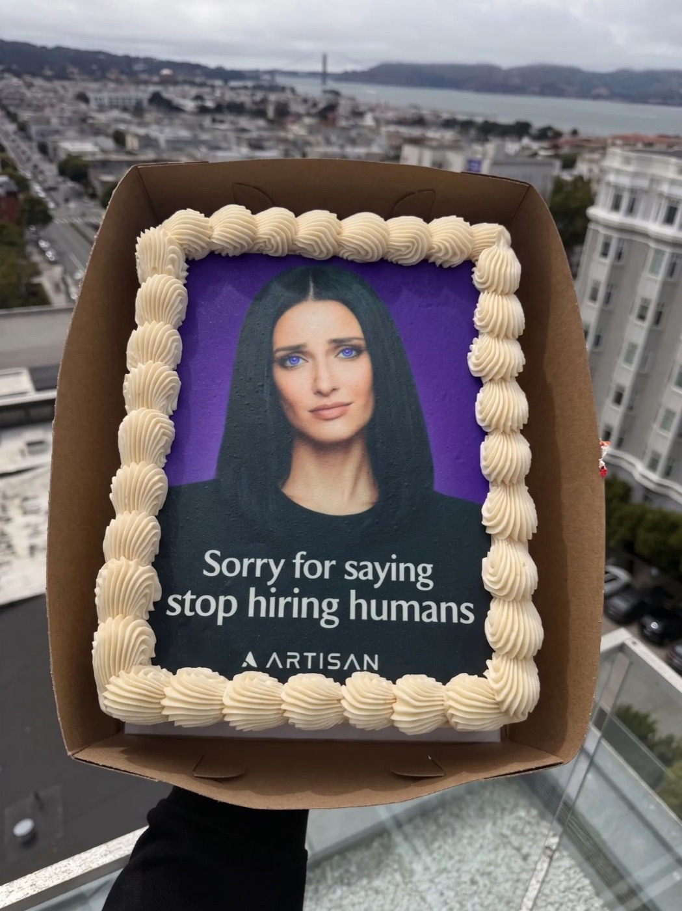

In 2005, the Scarlet Witch looked at the crowded, super-powered Marvel Universe and said three words: **"No more mutants."** Nearly every mutant on Earth woke up powerless.

Some days I want to borrow her powers for a day and say **"No more AI."**

### Even I'm getting bored of AI

I know it's ironic. I put my notes together with AI, I build with AI, and I pay for premium AI access monthly (more than one service, too!). I love this stuff, because I love technology.

But some days I wake up and wonder what would happen if AI simply didn't exist. Wishful thinking, I know. That's not the world we live in. I don't think AI is "inevitable," but it's also not going anywhere. Still, some days I think about being Amish... okay maybe not Amish, but maybe taking us back to [1990s-era technology](https://www.youtube.com/watch?v=6-v1b9waHWY).

These days, I can't seem to get through a conversation, a meeting, or anything I read online without a mention of AI. We've hit a hyper-saturated point where it's all anyone talks about, and even I have to say I'm getting **_bored_**.

### _"It is our gift to you, San Francisco"_

I lived in San Francisco for 10 years, and I still keep in touch with people there. Apparently the city is just inundated with AI ads right now.

Like the ones that said **["Stop hiring humans."](https://www.instagram.com/p/DJ4PEDkxT8C/)** That was a real AI company's billboard campaign for two years. This summer they retired it, and the CEO [posted a cake](https://www.linkedin.com/posts/jaspar-carmichael-jack_we-made-a-cake-to-apologize-for-saying-stop-share-7503661720222183424-NX7g/) that said **"Sorry for saying stop hiring humans."** The new slogan? **"Be more human."** You can't make this stuff up, but Marvel came close.

 

If you follow comics, this all sounds familiar. Marvel did this exact story in 2014. In _Superior Iron Man_ #1, a morally inverted Tony Stark (thanks to a spell from, of all people, the Scarlet Witch) picks San Francisco to beta-test his newest invention, the [Extremis 3.0 app](https://marvel.fandom.com/wiki/Extremis_3.0_App). The pitch is right on the poster: **"BE beautiful, intelligent, healthy, immortal."** And it's free to everyone in the city. **"It is our gift to you, San Francisco."**

Everyone downloads it, and everyone loves it. **Then the free trial ends.**

**Daily renewal**: $99.99. Tony's explanation sounds like a real pricing announcement: **"It is an amazing product. I wish everyone could access it for free but the cost of making it available is astronomical."**

Free until you can't live without it, then a shrug about what it costs to run. That comic is 12 years old, but reads like an AI product roadmap from 2026.

### A _Stark_ comparison

Tony gets compared to real tech billionaires all the time, Elon Musk most of all. Robert Downey Jr. even suggested meeting Musk while they were building the movie version of Tony, and Musk has a cameo in _Iron Man 2_.

The comic version is the one worth reading, though. Superior Iron Man is Tony with his conscience switched off, a genius who has decided he knows what's best for everyone.

Swap Tony's armor for a leather jacket and a keynote stage, and you've pretty much got half the AI announcements I've seen this year.

### I'm looking forward to the pendulum swing

There's already some talk of [Gen Z going back to simpler products](https://www.engadget.com/2196894/ipods-comeback-gen-z/), and of people stepping away from phones loaded with every feature. I'm kind of looking forward to that swing.

I worry about us. We're not doing enough analog things in our day, we're not seeing enough of our friends, and we're not even collaborating enough at work. I think that becomes a real problem for us as a society, especially as we pull more people into the AI psychosis of it all.

### What I actually want is less screen time

Here's the funny part. Right now we're in the part of the timeline where working with technology is actually **_more difficult_**. I'm in front of a computer or a screen more often than ever.

The other day, I was sitting at Starbucks, taking a break, while my agent transferred my domain to a new registrar without me having to babysit it. We should be using AI to do the boring jobs we don't wanna do so we can take a break and stretch our legs. **We should use technology to enjoy our lives more.**

### The computer I actually want

I think about ambient computing, where there isn't much of a device at all, so there's a computer around your home that you trust and that can help you get tasks done without you having to stare at a screen. I've talked about the concept of [owning your context,](https://middleton.io/blog/owning-your-context/) where you can physically locate your personal data at your home so you don't have to worry about who might have access to it in the cloud. I think local AI and tasks are going to become a bigger and bigger thing as people reflect back on how companies like Meta betrayed their trust and profited from and/or leaked their personal data. Post-[Cambridge Analytica scandal](https://en.wikipedia.org/wiki/Facebook–Cambridge_Analytica_data_scandal), people still don't trust Meta, not with personal data and not with [AI "pervert" glasses](https://www.bbc.com/news/articles/cwp80l0my1x2o).

If anyone, maybe a company like Apple, can build up that trust layer with consumers, and people can affordably own their personal context at home on a physical device, then you could have an ambient computer that knows enough about you to be useful. It might even help you step away from all the technology and enjoy some tech-free moments that I think a lot of us are craving right now. **Great technology gets out of the way.**

There was and still is a backlash about AI in art and AI writing, and thankfully there are still people creating art and writing and they should keep working. Author Joanna Maciejewska said it best:

> "I want AI to do my laundry and dishes so that I can do art and writing, not for AI to do my art and writing so that I can do my laundry and dishes."

Where I think AI can shine is doing my taxes or finding unclaimed money for me... these are very much things I would like done on my behalf without me having to stare at a screen while it happens. I'd rather be out to brunch with friends or playing with my cats.

I'm not asking for Wanda-level powers to destroy all AI, and I definitely don't want Tony's Extremis 3.0 app. Let people own and control their personal data, and make it easy to host that data at home, outside of the cloud, where it's safer.

Then create truly useful AI agents that people can personally own and control. Agents that check our email for the stuff we can skip and make sure we read the ones from our friends. Agents that keep track of the little stuff so I don't miss movie night.

That way we can go outside and do things, like meeting our friends for dinner or planning Thanksgiving.

We have to intentionally build the world we want to live in, and while Wanda and Tony don't really exist in our universe, I think we can still learn a thing or two from them.
