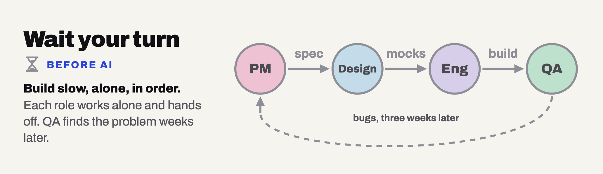
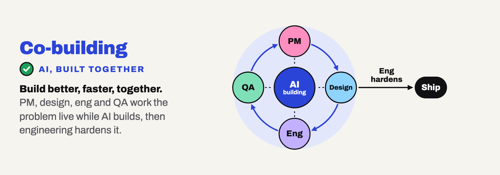

There have been several claims on LinkedIn recently declaring the product trio (product/design/tech lead) “dead”. The argument goes like this: AI lets PMs prototype, designers write SQL, and engineers make product calls, so why gate who can build when everyone can build now?

Just because everyone _can_ build doesn't mean everyone _should_ build.

What I'd do instead is **build with AI as a team**. I call it **co-building**: PM, design, engineering, and QA use AI to work the problem from PRD to design to fully working product concept together, live. AI builds realtime and then engineering hardens after the co-building session.

I build with AI almost every day, and I'm a fan. I wrote about [what it didn't change](https://middleton.io/blog/everyone-can-build-now/) back in June. But the best work I've shipped came from the trio plus QA and any stakeholders working through the problems together, and then handing off to engineers to harden it. That's a better way to ship than everyone going solo. AI makes that time together shorter, which is great news for anyone who hates meetings and rework.

Atlassian actually ran the experiment. Sherif Mansour, Atlassian's head of AI and product craft, told [Lenny Rachitsky](https://www.youtube.com/watch?v=hRtmV1mCBSE) they moved product managers and designers onto a team where everyone was an AI builder, with no PM or designer roles. A few weeks in, one of the PMs said they'd never moved faster. About a month in, everyone had gone back to their old jobs. His explanation: "We realized throughput's not our problem. Direction's our problem."

### I'd just joined the team, and v1 had already failed

At Rocket Lawyer, I wasn't new to the company, but I had just joined the Legal Docs team as its product manager. We were building interactive experiences into our legal document forms, and my first problem was that v1 of that work had failed. It hadn't been thought through, the requirements were faulty or missing, and nobody had walked the full user experience. We needed a v2 right away, so we were already "behind," which is not a great feeling when you're onboarding to a new team.

A lot of product managers’ first instinct would be to hole up somewhere, heads down, and think it all through alone. I went the other way. I say this often: I don't own good ideas. I was new to this team, I was probably missing some critical pieces, and since the first version had already failed, I needed v2 to work.

So I got the team into a conference room for an afternoon, and by team I mean engineering, design, and QA. We talked through the feature, why we were building it, and what went wrong with v1. Then we went through the user experience scenario by scenario and talked through the edge cases.

Without getting into the details of the features here, we got pretty deep in the weeds, because not doing for v1 was exactly why v1 failed. In our collaborative session, Design had input on the experience, Engineering could think through the solution while we walked the flows, and QA caught edge cases the rest of us would have missed.

Pulling the team together is one of my favorite "hacks," but it's really just good common sense: shrink the feedback loop.

V2 launched without a hitch with essentially no bugs, and we moved on to the next feature. We could have done it another way, the same way as v1, but it would have been worse, and it would have certainly taken longer.

### I was the third PM on a failing project

Years earlier, at Oracle, I was the third PM to take over a failing product. My read was the same: the real problem was the feedback loop, and we needed to bring the team together in one place to close it. I was in San Francisco, but we had team members in Atlanta, Austin, and Florida.

So I set up a war room in Atlanta for week since most of the team members were there. Since we were all together, Design and UX sat beside an engineer and me, with QA right there too, and we agreed on solutions to features and edge cases in real time. An engineer would show, to the pixel, how they were implementing something, and design could make micro adjustments on the spot by working with them.

We shipped five epics in a week and demoed to stakeholders that Friday. It was a huge success, and we would not have been successful if we had stayed siloed.

### What if every day felt like a hackathon (but better)?

At many companies, hackathons happen once a year, maybe twice. And the takeaways are always about the same: teams generally enjoy them and talk about how much they enjoyed the collaboration and how impressed they were by what the participants got done. The name fits, too. It's usually a _hackathon_ because you have to cobble something together very quickly.

I was talking about this with a colleague: imagine if we took those same ideas for hackathons and made them our normal way of building, with AI. Collaborative by default, where the whole team builds with AI, together, in the session, end-to-end instead of how we have been traditionally building or, with recent AI changes, solo building.

**Here's what I'm proposing**: the team moves to **co-building sessions**. The team sets aside an afternoon, gets on a virtual call or in a room together, and someone drives. Every co-building step happens in that session. There's no stopping and starting, or waiting for a different day to move forward. The team commits to getting it done there in the session:

1. **Someone brings a draft PRD**. Product might own it, but now that everyone's a builder, anybody could bring that piece.
2. **The co-building team stress tests and pokes holes**. We find the edge cases and resolve them, so we refine our starting inputs together.
3. **The co-building team gives these inputs to AI and build the prototype live, together**.
4. **The co-building team refines the prototype, and maybe start connecting the backend systems**.
5. **Engineering hardens what was built and prepares the feature to demo and ship**. The tech lead or an engineer is in the co-building session. On a smaller team, every engineer may be part of the session. Engineering still gets time after the session to go through what was built and harden it before launch.

It could take an hour, or it could take a couple of hours. But that's time well spent, because it's much faster than traditional product development.

Co-building excites me because it feels like something we always wanted to do but didn't have the technical capability to actually do. Now we can. **I am so curious why I don't hear about more teams working this way.**

My colleague's first word for it was "collaboration," which is spot-on, but it's also a word that's kind of lost its meaning. It's also what the Agile Manifesto meant all along by "individuals and interactions" and face-to-face conversation. But I wanted a phrase I could use with other teams, so I'm calling it **co-building**, and the people on the call **co-builders**. PM, design, engineering, QA, and an agent, building together, then handing it to engineering to harden.

### A long co-building session is not "more meetings," it's the right meeting.

Nobody wants to be labeled as a meeting lover. But you can't argue with the results.

AI changes has changed how long the product building takes, but AI alone has not changed how we reconfigure our teams to build the most effectively. Since we can build with agents now, some meetings take up less time, and if we're all engaged on a longer co-building calls, we can take the gains saved from wasting time in traditional or solo building, and instead grab an iced beverage of choice, and maybe celebrate some faster, less buggy team wins.

So no, the product trio is dead and it hasn't been replaced by solo builders. Everyone can build now, and I'm glad they can. But a solo builder loses the designer who says the flow is confusing, the engineer who's already thinking about how it gets built, and QA asking what happens when a field is blank. Get your co-builders into a session. It's time well spent and much better than solo building.
