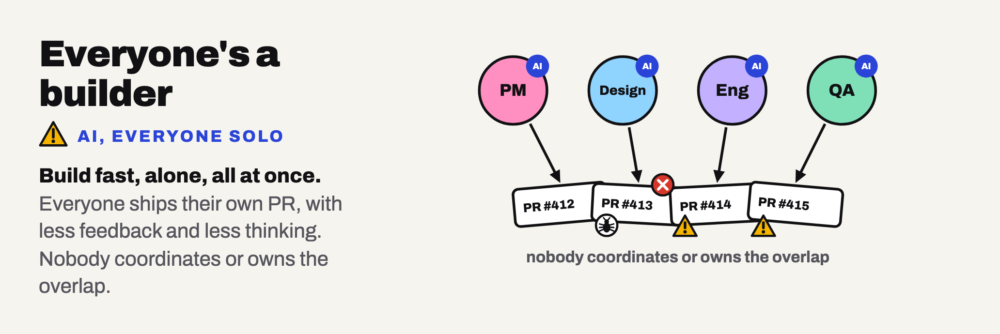

There have been several claims on LinkedIn recently declaring the product trio (product/design/tech lead) “dead”. The argument goes like this: AI lets PMs prototype, designers write SQL, and engineers make product calls, so why gate who can build when everyone can build now?

My take: just because everyone _can_ build doesn't mean everyone _should_ build.

What I'd do instead is **build with AI as a team**. I call it **co-building**: PM, design, engineering, and QA use AI to work the problem from PRD to design to fully working product concept together, live. AI builds realtime and then engineering hardens after the co-building session.

I build with AI almost every day, and I'm a fan. I wrote about [what it didn't change](https://middleton.io/blog/everyone-can-build-now/) back in June. But the best work I've shipped came from the trio plus QA and any stakeholders working through the problems together, and then handing off to engineers to harden it. That's a better way to ship than everyone going solo. AI makes that time together shorter, which is great news for anyone who hates meetings and rework.

Atlassian actually ran the experiment. Sherif Mansour, Atlassian's head of AI and product craft, told [Lenny Rachitsky](https://www.youtube.com/watch?v=hRtmV1mCBSE) they moved product managers and designers onto a team where everyone was an AI builder, with no PM or designer roles. A few weeks in, one of the PMs said they'd never moved faster. About a month in, everyone had gone back to their old jobs. His explanation: "We realized throughput's not our problem. Direction's our problem."

### I'd just joined the team, and v1 had already failed

At Rocket Lawyer, I wasn't new to the company, but I had just joined the Legal Docs team as its product manager. We were building interactive experiences into our legal document forms, and my first problem was that v1 of that work had failed. It hadn't been thought through, the requirements were faulty or missing, and nobody had walked the full user experience. We needed a v2 right away, so we were already "behind," which is not a great feeling when you're onboarding to a new team.

A lot of product managers’ first instinct would be to hole up somewhere, heads down, and think it all through alone. I went the other way. I say this often: I don't own good ideas. I was new to this team, I was probably missing some critical pieces, and since the first version had already failed, I needed version two to work.

So I got the team into a conference room for an afternoon, and by team I mean engineering, design, and QA. We talked through the feature, why we were building it, and what went wrong with v1. Then we went through the user experience scenario by scenario and talked through the edge cases.

One of the big features was real-time math inside the form. If you typed in what something costs and how many are included, you'd want to see the total. You would not want to see UNDEFINED while you were still filling things out. V1 seemed like it was built by an engineer, and the people using it were just trying to get a legal document done. So if two fields added together and one was still blank, the total kept updating anyway. If a division field was blank, we didn't throw an error. We counted the denominator as 1 (zero would have been a bad time) until the user typed something in.

That's deep in the weeds, and I still remember it, because it's exactly what the room is for. Design had input on the experience. Engineering could think through the solution while we walked the flows. And QA caught the exceptional cases the rest of us would have missed, which I'm still thankful for.

This is one of my favorite "hacks," and it's really just good common sense: shrink the feedback loop. Fancier people call it alignment. I call it making sure we all have the same understanding and agree on the solution.

V2 launched with essentially no bugs, and without a hitch, and we moved on to the next feature. We could have done it another way. It would have been worse, and it would have taken longer.

## I was the third PM on a failing project

Years earlier, at Oracle, I was the third PM to take over a project that was failing. My read was the same: the real problem was the feedback loop, and we needed to bring the team together in one place to close it.

So we set up a war room. Design sat beside the engineer and me, with QA right there too, and we agreed on solutions to edge cases in real time. An engineer would show, to the pixel, how they'd implemented something, and design could make adjustments on the spot by working with them.

We shipped five epics in a week and demoed to stakeholders that Friday.

## Half the job is being a buffer

The trio working the problem together is half of it. The other half is handing it to engineers to harden, and then protecting their time so they can.

When I built out the partner platform at Rocket Lawyer, the team was small: me, a tech lead, part-time design help, and two engineers. The timeline was aggressive, our partner was about to take a month of vacation, and I was still onboarding to the business. It was my first deliverable as a new employee.

I synced with my tech lead daily, at times that worked for him, so he could stay focused on the build. I drew up technical diagrams for how our auth system was going to work, and we were incredibly honest with each other about timelines. When a bug squash mandate came down, I held it off and even closed some bugs as "will not fix" so the team could keep its focus. We launched on time.

I wrote on LinkedIn earlier this year that half the job is being a buffer, and I still believe it. The trio agrees on what we're building, and then my job is to keep everything else from interrupting the people building it.

## What if every day felt like a hackathon?

It seems to me that hackathons happen once a year, maybe twice. And the takeaways are always about the same: teams really enjoy them. We talk about how much we enjoyed the collaboration and how impressed we were by what we got done. The name fits, too. It's usually a hackathon because we had to cobble something together very quickly.

I was talking about this with a colleague, and here's where we landed: imagine if we took those same ideas and made them our normal way of building, with AI. Collaborative by design, and afterward we take the step to properly build out and ship what we put together. Collaborative by default. The whole team builds with AI, together, in the session.

Here's what I'm proposing: a co-building session. The team sets aside an afternoon, gets on a virtual call or in a room together, and someone drives. Every step happens in that one session. No stopping and starting, no waiting for a different day.

1. Someone brings a draft PRD. Product might own it, but now that everyone's a builder, anybody could bring that piece.
2. We stress test it and poke holes as a team. We find the edge cases and resolve them, so we refine our starting inputs together.
3. We give that to AI and build the prototype live, together.
4. We refine the prototype, and maybe start connecting the backend systems.
5. Then engineering hardens it. The tech lead or an engineer is in the session the whole time, and on a small team it might be every engineer. Engineering still gets time afterward to go through what was built and harden it.

It could take an hour, or it could take a couple of hours. That's time well spent, because it's much faster than product development of the past.

That feels like something we always wanted to do but didn't have the technical capability for. Now we do. So why don't I see and hear more people working this way?

My colleague's first word for it was "collaboration," which is fair. It's also what the Agile Manifesto meant all along by "individuals and interactions" and face-to-face conversation. But I wanted a name I could say out loud to other teams, so I'm calling it co-building, and the people on the call co-builders. PM, design, engineering, QA, and an agent, building the thing together, then handing it to engineering to harden.

## I was worried about being the PM with too many meetings

That label was my big concern back then. But you can't argue with the results.

What AI changes is how long the room takes. The Oracle war room can happen on a shared call now, and it can happen even faster. Since we can build with agents, those meetings take up less time, and if we're all engaged on those even shorter calls, we can take the gains, grab an iced beverage of choice, and celebrate our team wins.

So no, I don't think the trio is dead. Everyone can build now, and I'm glad they can. But a solo builder loses the designer who says the flow is confusing, the engineer who's already thinking about how it gets built, and QA asking what happens when a field is blank. Get your co-builders on the call. It'll be shorter than you think.
